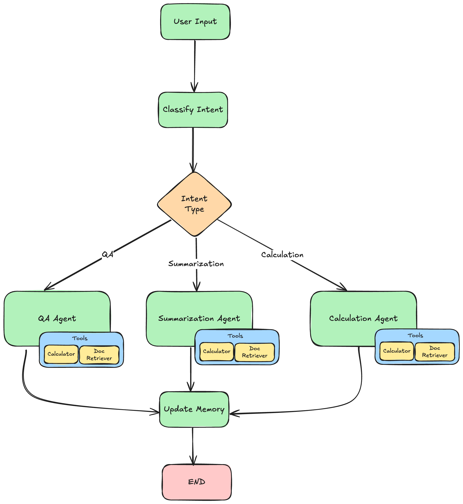

# DocDacity ドキュメントアシスタント

LangChain と LangGraph で構築した、マルチエージェント型のドキュメント処理アシスタントです。請求書・契約書・保険請求といった財務／医療系ドキュメントについて、ユーザーの質問に答える（Q&A）、内容を要約する、ドキュメント内の数値を使って計算する、という 3 種類のリクエストに対応します。

ユーザーの入力はまず LLM によって意図（intent）が分類され、その結果に応じて専用のエージェントにルーティングされます。各エージェントはツール（ドキュメント検索・読み取り・統計・電卓）を使う ReAct エージェントとして動作し、Pydantic スキーマによる構造化出力で回答を返します。最後に会話の要約と参照中のドキュメントがメモリに保存され、`InMemorySaver` チェックポインタによって同じセッション内の複数ターンにわたって状態が保持されます。



```
classify_intent --> [qa | summarization | calculation] --> update_memory --> END
```

## はじめに

以下の手順で、ローカルマシン上でアシスタントを動かせます。作業はすべて `starter/` ディレクトリで行います。

### 依存関係

- Python 3.9 以上（開発環境では Python 3.11 を使用）
- OpenAI API キー（または OpenAI 互換 API のエンドポイント）
- [starter/requirements.txt](starter/requirements.txt) に記載のパッケージ

```
langchain>=0.2.0
langgraph>=0.6.7
langchain-openai>=0.1.0
langchain-core>=0.2.0
pydantic>=2.0.0
python-dotenv>=1.0.0
openai>=1.0.0
print-color>=0.4.6
pytest>=8.0.0
```

### インストール

1. `starter` ディレクトリに移動します。

```bash
cd project/starter
```

2. 仮想環境を作成して有効化します。

```bash
python -m venv venv
source venv/bin/activate  # Windows の場合: venv\Scripts\activate
```

3. 依存パッケージをインストールします。

```bash
pip install -r requirements.txt
```

4. `.env.example` をコピーして `.env` を作成し、値を設定します。

```bash
cp .env.example .env
```

| 変数 | 必須 | 説明 |
| --- | --- | --- |
| `OPENAI_API_KEY` | ○ | OpenAI の API キー。未設定の場合は起動時にエラーになります |
| `MODEL_NAME` | ○ | 使用するモデル名（例: `gpt-4o`） |
| `BASE_URL` | - | OpenAI 互換 API を使う場合のエンドポイント。`.env.example` には含まれていないため、必要に応じて追記してください |

5. アシスタントを起動します。

```bash
python main.py
```

起動するとユーザー ID の入力を求められます（Enter で `demo_user`）。その後、メッセージを入力すると回答と一緒に分類された意図、参照したドキュメント、使用したツール、会話の要約が表示されます。

```
/help  - ヘルプを表示
/docs  - 利用可能なドキュメントの一覧を表示
/quit  - 終了

入力例:
  - What's the total amount in invoice INV-001?
  - Summarize all contracts
  - Calculate the sum of all invoice totals
  - Find documents with amounts over $50,000
```

会話セッションは `sessions/` に、ツールの使用ログは `logs/` に JSON 形式で保存されます。

## 実装の詳細

### 実装上の判断

- **ノード名を意図の値と揃える**: グラフのノード名を `qa` / `summarization` / `calculation` にして、`classify_intent` が設定する `next_step` の値と一致させています。これにより、条件付きエッジの対応表が単純になります。`actions_taken` には `qa_agent` などのエージェント名を記録します。
- **不明な意図は Q&A に回す**: 意図が `unknown` などの想定外の値だった場合は、既定の Q&A エージェントにフォールバックします。
- **エージェントノードは共通パターンで実装**: 3 つのエージェントはどれも「意図別のプロンプトを取得 → ReAct エージェントを実行 → 状態を更新」という同じ流れで、違いはシステムプロンプトと出力スキーマだけです。共通部分は `invoke_react_agent` にまとめています。
- **計算は必ず電卓ツールで行う**: `CALCULATION_SYSTEM_PROMPT` で、どんなに簡単な計算でも電卓ツールを使い、LLM 自身では計算しないよう指示しています。
- **電卓ツールの安全対策**: `$` と `,` を取り除いたうえで、数字・空白・`+ - * / % ( ) .` だけを正規表現で許可し、`__builtins__` を空にして `eval()` を実行します。不正な式やゼロ除算は例外を投げず、エラーメッセージとして返したうえでログに残します。
- **LLM を使わないテスト**: テストでは LLM と ReAct エージェントをスタブに置き換え、API キーなしでワークフロー全体を決定的に検証できるようにしています。

### 状態とメモリの動作

- **状態（`AgentState`）**: `messages` には `add_messages` リデューサーを、`actions_taken` には `operator.add` リデューサーを指定しています。そのため、どちらも上書きされずに追記されます。それ以外のフィールド（`intent`、`next_step`、`current_response` など）は、ノードが返した値で上書きされます。
- **チェックポインタ**: ワークフローは `InMemorySaver` 付きでコンパイルし、`thread_id` にセッション ID を渡します。同じセッション内では前のターンの状態が引き継がれるため、`messages`（会話履歴）と `actions_taken` がターンを重ねるごとに蓄積されます。
- **会話メモリ（`update_memory`）**: 各ターンの最後に、それまでの全メッセージを LLM で要約し、`conversation_summary`（会話の要約）と `active_documents`（直近の話題に関係するドキュメント ID）を更新します。
- **セッションの保存**: `DocumentAssistant` は各ターンの最終状態を `sessions/<session_id>.json` に保存し、参照したドキュメント ID を和集合で `document_context` に蓄積します。
- **制約**: `InMemorySaver` の状態はプロセスのメモリ上にしかないため、アプリを再起動すると会話の文脈は失われます。セッションの JSON は記録として残りますが、チェックポインタの状態は復元されません。

### 構造化出力の強制方法

- **意図分類とメモリ更新**: `llm.with_structured_output(UserIntent)` と `llm.with_structured_output(UpdateMemoryResponse)` を使い、LLM の出力を Pydantic モデルとして直接受け取ります。`UserIntent.intent_type` は `Literal["qa", "summarization", "calculation", "unknown"]` で、これ以外の値は受け付けません。
- **各エージェントの回答**: `create_agent(..., response_format=スキーマ)` に `AnswerResponse` / `SummarizationResponse` / `CalculationResponse` を渡します。LangChain はスキーマを「最終回答用のツール」として LLM に提示するため、エージェントはツールを使い終えた後、スキーマどおりの形式で回答を返します。結果は `current_response["structured_response"]` に入ります。`tools_used` にスキーマ名（例: `CalculationResponse`）が含まれるのはこのためです。
- **スキーマでの検証**: `confidence` を `0.0〜1.0` に制限し（`AnswerResponse`）、`sources` や `timestamp` には既定値を設定しています。これにより、LLM が一部のフィールドを省略しても有効な応答になります。

## 会話例

`user1` の 1 セッション（4 ターン）の実際の記録です（[sessions/9273134b-bfa3-4a7f-9bfc-7940776ce031.json](starter/sessions/9273134b-bfa3-4a7f-9bfc-7940776ce031.json)）。要約・計算・Q&A の 3 機能、ツールの使用、構造化出力、ターンをまたいだメモリをすべて確認できます。応答は抜粋です。

**ターン 1: 要約**

```
Enter Message: Summarize all contracts

🤖 Assistant: Returning structured response: original_length=844
  summary="There is 1 contract on file. CON-001 — Service Agreement
  - Parties: DocDacity Solutions Inc. (Provider) and Healthcare Partners LLC (Client) ..."
  key_points=['One contract found: CON-001', 'Total value: $180,000', 'Monthly fee: $15,000',
              'Term: 12 months', "Termination requires 60 days' written notice", ...]
  document_ids=['CON-001']

INTENT: summarization
SOURCES: CON-001
TOOLS USED: document_search, document_reader, SummarizationResponse
```

**ターン 2: 計算**

```
Enter Message: Calculate the sum of all invoice totals

🤖 Assistant: Returning structured response: expression='20000 + 69300 + 214500' result=303800.0
  explanation='Summed the invoice totals from documents INV-001, INV-002, and INV-003:
  $20,000 + $69,300 + $214,500 = $303,800.' units='USD'

INTENT: calculation
SOURCES: CON-001, INV-001, INV-002, INV-003
TOOLS USED: ..., document_search, document_reader, document_reader, document_reader, calculator, CalculationResponse
```

**ターン 3: Q&A（金額による検索）**

```
Enter Message: Find documents with amounts over $50,000

🤖 Assistant: Returning structured response: question='Find documents with amounts over $50,000'
  answer='Found 3 documents with amounts over $50,000:
  - INV-003 — Invoice #12347 — $214,500.00
  - CON-001 — Service Agreement — $180,000.00
  - INV-002 — Invoice #12346 — $69,300.00'
  sources=['INV-003', 'CON-001', 'INV-002'] confidence=0.99

INTENT: qa
TOOLS USED: ..., document_search, AnswerResponse
```

**ターン 4: 計算（メモリの確認）**

```
Enter Message: What's the total amount in invoice INV-001?

🤖 Assistant: Returning structured response: expression='20000 + 2000' result=22000.0
  explanation='Using invoice INV-001, the subtotal is $20,000 and the tax is $2,000,
  so the total amount is $20,000 + $2,000 = $22,000.' units='USD'

INTENT: calculation
CONVERSATION SUMMARY: Conversation covered document summarization and financial analysis ...
  - Sum of all invoice totals: INV-001 $20,000 + INV-002 $69,300 + INV-003 $214,500 = $303,800.
  - Documents with amounts over $50,000: INV-003 ($214,500), CON-001 ($180,000), INV-002 ($69,300).
  - Total amount in invoice INV-001: subtotal $20,000 plus tax $2,000 = $22,000.
```

このセッションで確認できる点は次のとおりです。

- 4 ターン目の会話の要約に、1〜3 ターン目の内容が含まれており、メモリがターンをまたいで保持されています。
- 4 ターン後の `actions_taken` は `['classify_intent', 'summarization_agent', 'classify_intent', 'calculation_agent', 'classify_intent', 'qa_agent', 'classify_intent', 'calculation_agent']` で、`operator.add` によって各ターンのノードが蓄積されています。
- 計算はすべて `calculator` ツールで行われています。
- **既知の制限**: INV-001 には「Total Due」の行がないため、ターン 2 では小計の $20,000 を請求額として合計しています。ターン 4 では税込みの $22,000 を正しく計算しており、どの値を「合計」とみなすかは LLM の解釈に依存します。

## テスト

テストは [starter/tests/test_assistant.py](starter/tests/test_assistant.py) にあります。LLM と ReAct エージェントはスタブに置き換えているため、API キーがなくてもオフラインで決定的に実行できます。`starter/` ディレクトリで次のコマンドを実行してください。

```bash
venv/bin/python -m pytest -v
```

現在、18 件のテストがすべて成功します。

### テストの内訳

テストは README の「Testing Your Implementation」に沿って 3 つのグループに分かれています。

**1. ユニットテスト**: 個々の関数をサンプル入力で確認します。

| テスト | 内容 |
| --- | --- |
| `test_answer_response_defaults` | `AnswerResponse` が question と answer だけで生成でき、他のフィールドに既定値が入ること |
| `test_user_intent_fields` | `UserIntent` がルーティングに使うフィールドを保持すること |
| `test_calculator` | 電卓が演算子の優先順位を守り、`$` や `,` を含む金額表記を受け付け、小数を保持すること |
| `test_calculator_logs_usage` | ツールの呼び出しが `ToolLogger` に記録されること |
| `test_document_reader_found` | `document_reader` が既存ドキュメントの全文を返すこと |
| `test_document_search_over_amount` | 金額検索（「$50,000 超」）で閾値を超えるドキュメントだけが返ること |

**2. 結合テスト**: ワークフロー全体を通して実行します。

| テスト | 内容 |
| --- | --- |
| `test_routes_by_intent_and_updates_memory` | calculation の意図で `classify_intent → calculation → update_memory` と進み、正しいスキーマで状態が更新されること |
| `test_qa_workflow` | qa の意図で Q&A エージェントにルーティングされ、`AnswerResponse` で回答されること |
| `test_summarization_workflow` | summarization の意図で要約エージェントにルーティングされ、`SummarizationResponse` で回答されること |
| `test_actions_accumulate_across_turns` | チェックポインタと `operator.add` リデューサーにより、同一スレッドでは `actions_taken` がターンをまたいで蓄積されること |
| `test_unknown_intent_falls_back_to_qa` | 想定外の意図（unknown）が既定の Q&A エージェントにフォールバックすること |

**3. エッジケース**: エラー処理を確認します。

| テスト | 内容 |
| --- | --- |
| `test_calculator_invalid_expression` | コードインジェクション・ゼロ除算・空の式に対して、例外やコード実行ではなくエラーメッセージを返すこと |
| `test_document_reader_missing_id` | 存在しないドキュメント ID に対して「not found」メッセージを返すこと |
| `test_document_search_no_results` | 該当なしの検索で「no documents」メッセージを返すこと |

```
$ venv/bin/python -m pytest -q
..................                                                       [100%]
18 passed
```

## プロジェクトの指示

受講生が実装する課題の詳細は [starter/README.md](starter/README.md)（日本語版: [starter/README_ja.md](starter/README_ja.md)）に記載されています。課題の一覧は次のとおりです。

| 課題 | ファイル | 内容 |
| --- | --- | --- |
| 1.1 | `src/schemas.py` | Q&A の構造化出力用 `AnswerResponse` スキーマ |
| 1.2 | `src/schemas.py` | 意図分類用 `UserIntent` スキーマ |
| 2.1 | `src/agent.py` | `AgentState` の構造の理解 |
| 2.2 | `src/agent.py` | `classify_intent` ノード（構造化出力で意図を分類し、`next_step` を設定） |
| 2.3 | `src/agent.py` | `summarization_agent` と `calculation_agent` ノード |
| 2.4 | `src/agent.py` | `update_memory` ノード（会話の要約と参照ドキュメントの更新） |
| 2.5 | `src/agent.py` | `create_workflow` によるグラフ構築（ノード、条件付きエッジ、エッジ） |
| 2.6 | `src/agent.py`, `src/assistant.py` | `actions_taken` への `operator.add` リデューサー、`InMemorySaver` でのコンパイル、`process_message` の `config` 設定 |
| 3.1 | `src/prompts.py` | 意図に応じてシステムプロンプトを切り替える `get_chat_prompt_template` |
| 3.2 | `src/prompts.py` | 電卓ツールを必ず使うよう指示する `CALCULATION_SYSTEM_PROMPT` |
| 4.1 | `src/tools.py` | 入力を検証したうえで式を評価し、使用ログを残す電卓ツール |

### ディレクトリ構成

```
starter/
├── src/
│   ├── schemas.py        # Pydantic モデル（構造化出力・セッション状態）
│   ├── retrieval.py      # ドキュメント検索（ベクトル DB を使わないシミュレーション）
│   ├── tools.py          # エージェントのツール（検索・読み取り・統計・電卓）
│   ├── prompts.py        # プロンプトテンプレート
│   ├── agent.py          # LangGraph のワークフロー
│   └── assistant.py      # セッション管理とワークフロー呼び出し
├── tests/                # pytest のテスト
├── docs/                 # アーキテクチャ図
├── sessions/             # 保存された会話セッション
├── logs/                 # ツールの使用ログ
├── main.py               # エントリポイント（対話型 CLI）
└── requirements.txt      # 依存パッケージ
```

### サンプルドキュメント

`SimulatedRetriever` には次の 5 件のサンプルドキュメントがメモリ上に読み込まれています。

| ID | 種類 | 内容 |
| --- | --- | --- |
| `INV-001` | 請求書 | Acme Corporation 宛、小計 $20,000 |
| `INV-002` | 請求書 | TechStart Inc. 宛、合計 $69,300 |
| `INV-003` | 請求書 | Global Corp 宛、合計 $214,500 |
| `CON-001` | 契約書 | Healthcare Partners LLC との 12 か月のサービス契約、総額 $180,000 |
| `CLM-001` | 保険請求 | 医療費の払い戻し請求、請求額 $2,450 |

## 使用技術

* [LangGraph](https://langchain-ai.github.io/langgraph/) - エージェントのワークフロー（状態グラフ、条件付きルーティング、チェックポインタ）
* [LangChain](https://python.langchain.com/) - ReAct エージェント、ツール（`@tool`）、プロンプトテンプレート
* [LangChain OpenAI](https://python.langchain.com/docs/integrations/chat/openai/) - `ChatOpenAI` による LLM 呼び出し
* [OpenAI API](https://platform.openai.com/docs/) - 意図分類・回答生成・要約に使う LLM
* [Pydantic](https://docs.pydantic.dev/) - 構造化出力とセッション状態のスキーマ定義
* [python-dotenv](https://github.com/theskumar/python-dotenv) - `.env` からの環境変数の読み込み
* [print-color](https://pypi.org/project/print-color/) - CLI 出力の色付け
* [pytest](https://docs.pytest.org/) - テストフレームワーク

## ライセンス
[ライセンス](../LICENSE.md)
